<h1 align="center">Online Store Orders Management System</h1>

<p align="center">
  <strong>A C++17 order-management backend with a React dashboard and six custom data structures.</strong>
</p>

<p align="center">
  
  
  
  
  
</p>

<p align="center">
  <a href="#features">Features</a> ·
  <a href="#screenshots">Screenshots</a> ·
  <a href="#data-structures">Data Structures</a> ·
  <a href="#getting-started">Getting Started</a> ·
  <a href="#testing">Testing</a> ·
  <a href="API.md">API Reference</a>
</p>

<p align="center">
  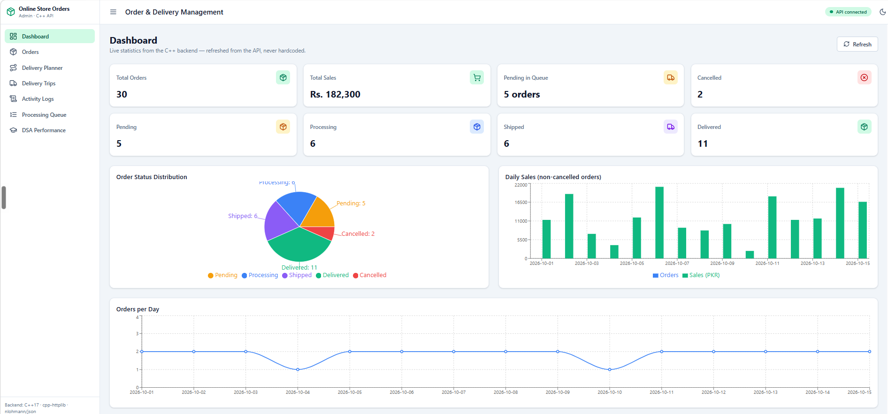
</p>

## Overview

Manage orders from creation to delivery through a local web interface. Search by order ID, process the Pending queue, undo supported actions, inspect the audit history and plan delivery trips between Pakistani cities.

The C++ `Store` owns the business rules and CSV persistence. The React frontend communicates with it through a localhost HTTP API. A console application uses the same Store implementation.

Built as a **Data Structures and Algorithms semester project** for the BS Artificial Intelligence program at **Riphah International University**.

## Features

| Feature | What the system does |
| --- | --- |
| Order management | Create, search, filter, update, cancel and delete orders |
| Processing queue | Process Pending orders in FIFO order |
| Undo | Restore supported status actions and the original queue position |
| Activity history | Display a chronological timeline, filters and per-order history |
| Delivery planning | Calculate the fastest route, detour costs and exact stop ordering |
| Trip management | Assign Processing orders, complete trips and cancel Planned trips |
| DSA visualizations | Show tree structure, queue state and search node-visit comparisons |

## Screenshots

These screenshots come from the Windows demonstration documented in the finalized report. They show different moments in the session, so order, trip and log counts can differ.

### Order management

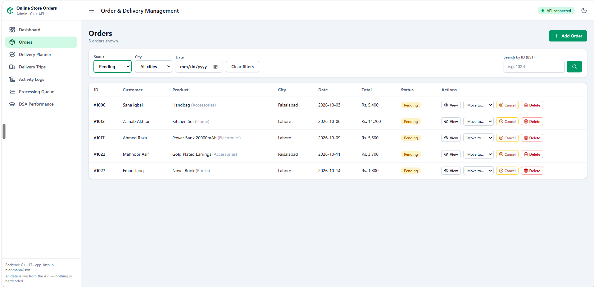

<details>
<summary><strong>Order details and delivery history</strong></summary>

Order #1016 after explicit trip completion, with assignment and completion entries retained in its history.

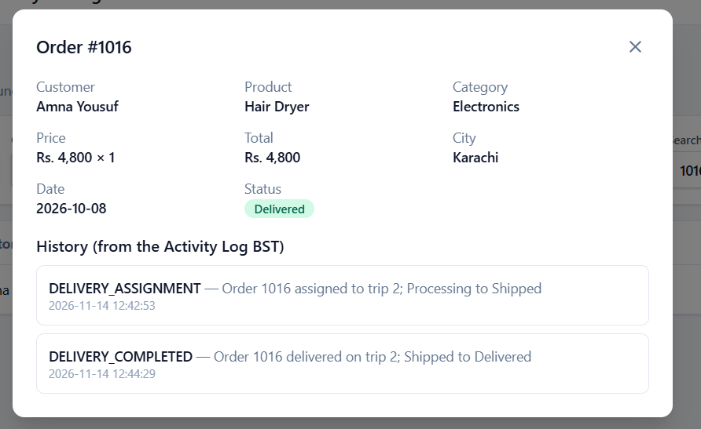

</details>

### FIFO processing queue

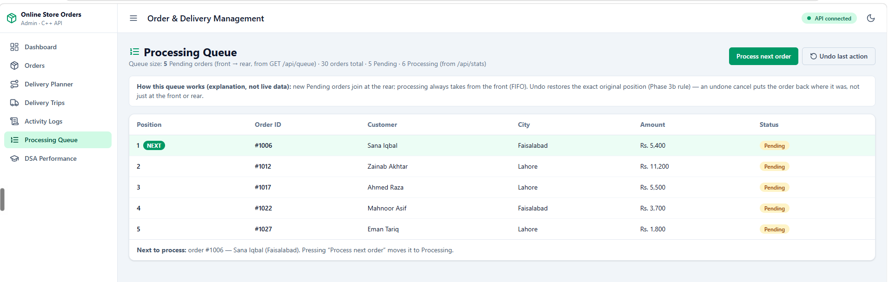

### Delivery planning

Production route: **Lahore to Karachi, 900 minutes and 1,210 km**. The objective is minimum travel time. Distance describes the selected route.

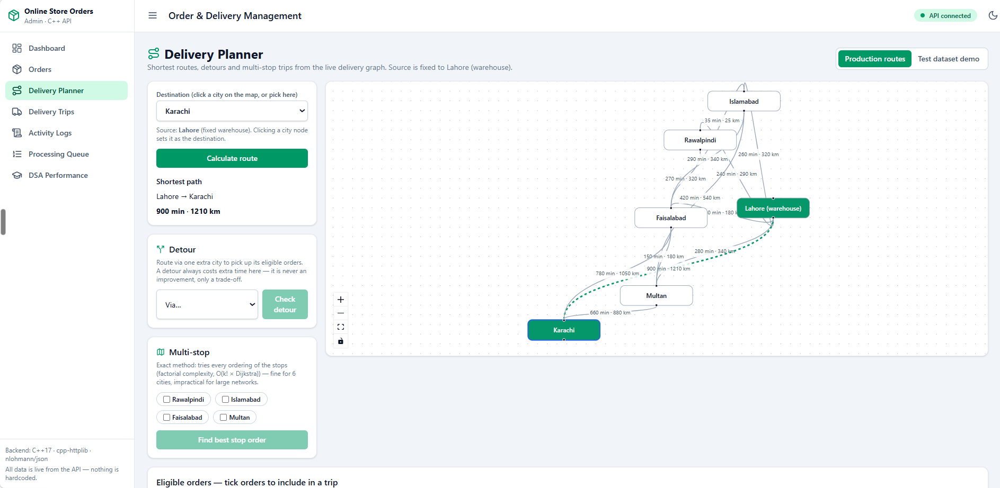

<details>
<summary><strong>Detour cost comparison</strong></summary>

Via Faisalabad: **930 minutes and 1,230 km**, adding **30 minutes and 20 km** to the direct Karachi route.

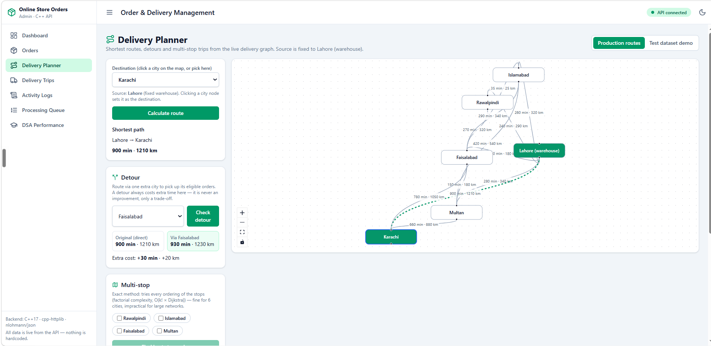

</details>

<details>
<summary><strong>Intermediate-city matching with the separate test graph</strong></summary>

The test dataset removes the Lahore-Islamabad direct road. Dijkstra then selects **Lahore, Rawalpindi, Islamabad**, taking **275 minutes and 315 km**. Orders #1005 and #1021 match Rawalpindi. Production roads remain unchanged, and the frontend disables trip creation in test mode.

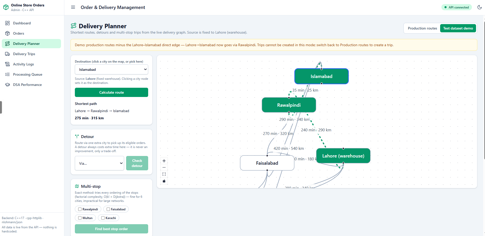

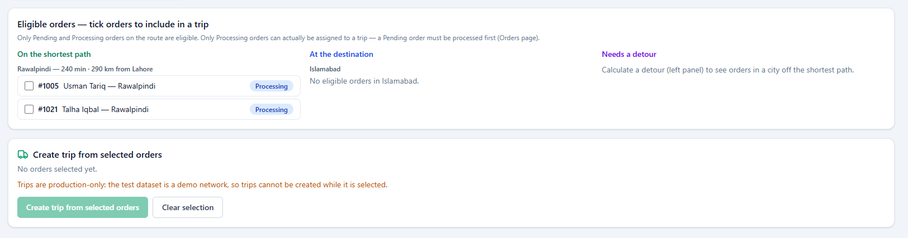

</details>

### Delivery trips

Only Processing orders may be assigned to a trip. Assignment marks them Shipped. Explicit completion marks them Delivered. Cancelling a Planned trip releases its orders back to Processing.

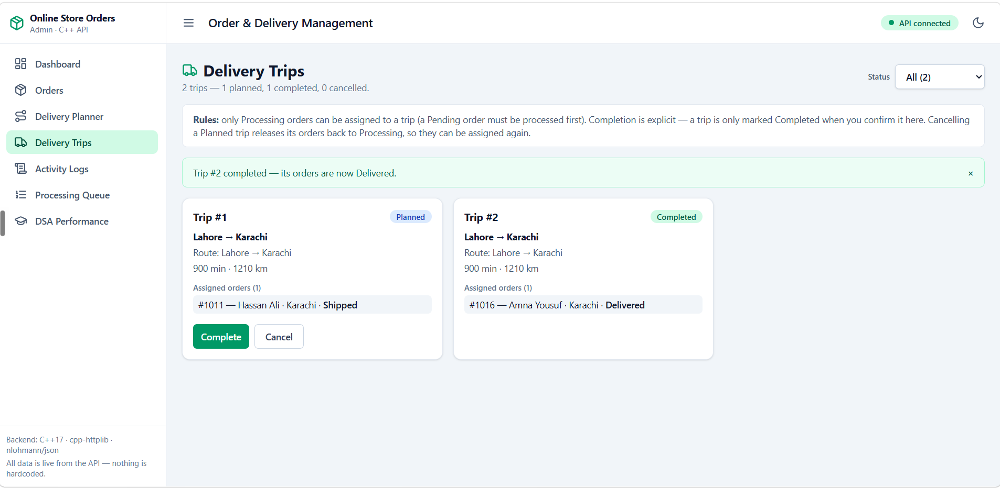

### Activity Log BST

The tree uses `(timestamp, logId)` as its key. Inorder traversal gives chronological history. The screenshot shows a tree excerpt, including its right-leaning shape.

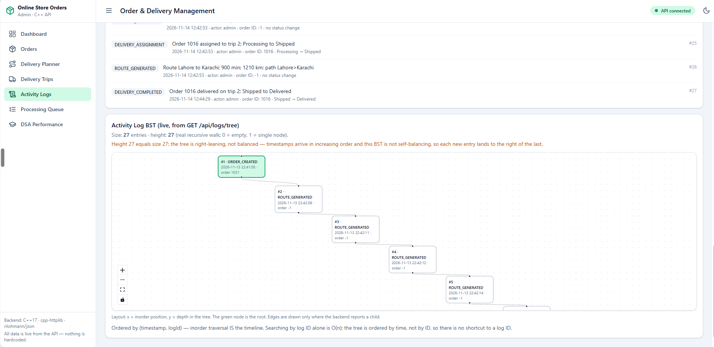

### Linked List vs BST benchmark

On the clean 30-order dataset, the same **1,000 searches** visit **16,400 nodes** in the Linked List and **4,600 nodes** in the Order BST. These are node visits, rather than elapsed-time measurements.

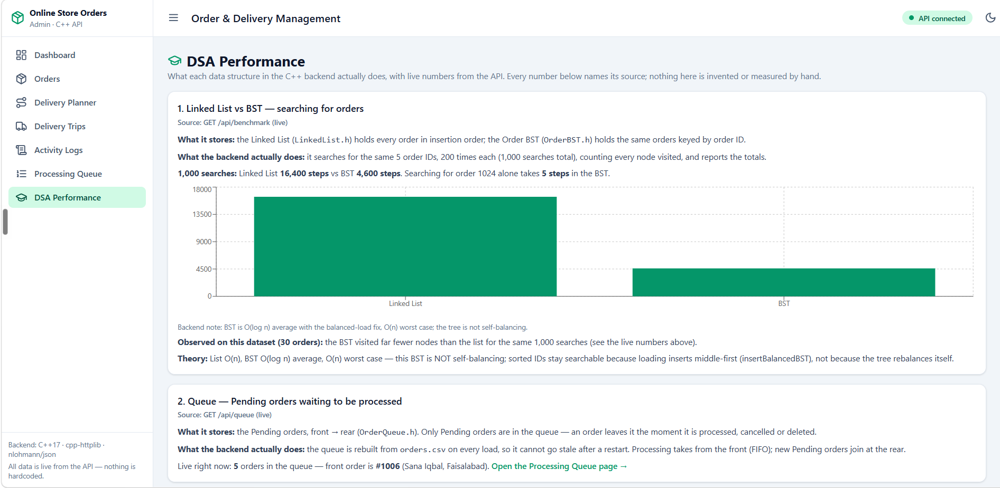

## Data Structures

| Custom structure | Source | Role and complexity |
| --- | --- | --- |
| Linked List | [`LinkedList.h`](LinkedList.h) | Stores all orders. Append O(1) with a tail pointer. Search and deletion by ID O(n). |
| Queue | [`OrderQueue.h`](OrderQueue.h) | Pending orders in FIFO order. Enqueue and dequeue O(1). Removal or restoration at a specific position can take O(n). |
| Stack | [`ActionStack.h`](ActionStack.h) | Supported undo actions in LIFO order. Push and pop O(1). |
| Order BST | [`OrderBST.h`](OrderBST.h) | Order-ID index. Lookup O(h), where h is height. O(log n) for a balanced shape, O(n) worst case. |
| Activity Log BST | [`ActivityLog.h`](ActivityLog.h) | Chronological index. Timeline and log-ID search O(n). Insertion includes an O(n) duplicate-ID scan. |
| Weighted Graph | [`DeliveryGraph.h`](DeliveryGraph.h) | Cities and roads with travel time and distance. Dijkstra uses an O(V²) vertex scan. |

The Order BST loads IDs middle-first. It does **not** rebalance after later insertions. The Activity Log BST can become skewed as timestamps arrive in order.

These costs describe structure operations. Complete application actions also perform validation, update other structures and save CSV state.

### Routing examples

| Route from Lahore | Time | Distance | Dataset |
| --- | --- | --- | --- |
| Karachi, direct | 900 min | 1,210 km | Production |
| Karachi via Faisalabad | 930 min | 1,230 km | Production |
| Karachi via Faisalabad then Multan | 960 min | 1,240 km | Production |
| Islamabad via Rawalpindi | 275 min | 315 km | Separate test graph |

[`Delivery.h`](Delivery.h) evaluates every permutation of requested stops and selects the least total travel time. The exact method accepts at most six stops. Route values come from the supplied project CSVs, rather than live traffic or mapping services.

## Architecture

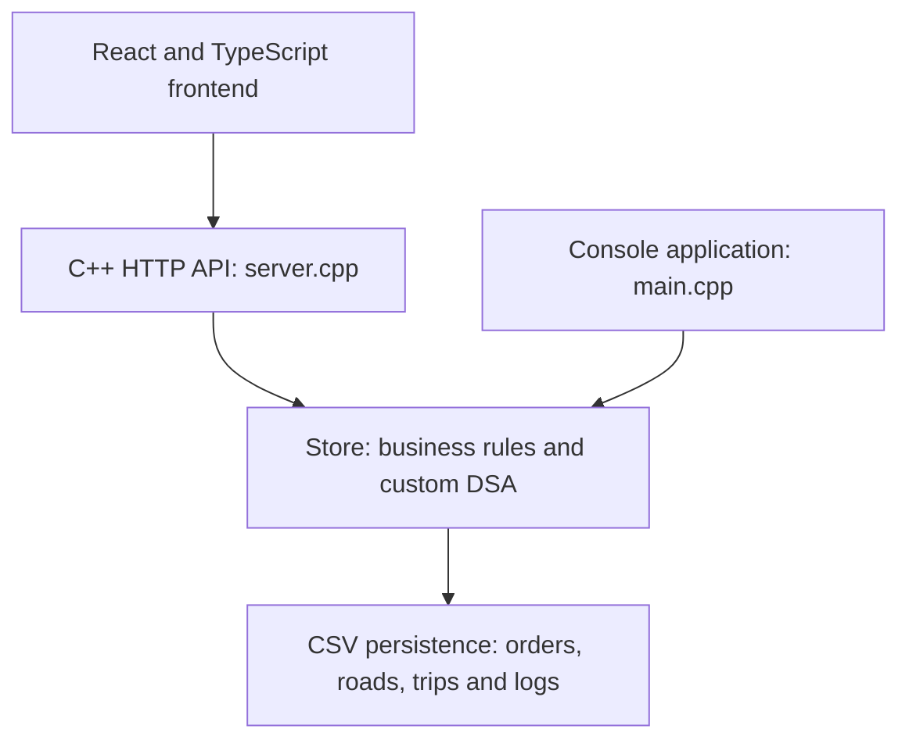

| Component | Technology |
| --- | --- |
| Backend | C++17, cpp-httplib, nlohmann/json |
| Frontend | React 19, TypeScript, Vite 6, Tailwind CSS 4 |
| Visualization | Recharts and React Flow |
| Persistence | `orders.csv`, `delivery_routes.csv`, `delivery_trips.csv`, `activity_logs.csv` |
| Testing | C++ regression suite, shell API integration checks and Vitest |

The API binds to **127.0.0.1:8080**. CORS permits the frontend at `http://localhost:5173` and `http://127.0.0.1:5173`. The standalone Python `app.py` is a legacy demonstration GUI, separate from the React/C++ application.

## Getting Started

### Requirements

- A C++17 compiler, such as MinGW-w64 g++ on Windows
- Node.js 22 or newer with npm
- Git Bash and Python 3 for the optional API integration script

### 1. Build and start the backend

From the project root, in Windows PowerShell:

```powershell
g++ -std=c++17 -Wall -Wextra -D_WIN32_WINNT=0x0A00 server.cpp Store.cpp -o server.exe -lws2_32
.\server.exe 8080 .
```

On Linux:

```bash
g++ -std=c++17 -Wall -Wextra server.cpp Store.cpp -o server -pthread
./server 8080 .
```

The clean dataset starts with **30 orders, 5 Pending orders, 0 trips and 0 log entries**. The first queued order is **#1006**. Trip and activity-log CSVs are created as the application is used.

### 2. Start the frontend

In a second terminal, from the project root:

```powershell
cd frontend
npm ci --include=dev --include=optional
npm run dev
```

Open **[http://localhost:5173](http://localhost:5173)**. Keep both servers running.

### 3. Console application (optional)

From the project root:

```powershell
g++ -std=c++17 -Wall -Wextra main.cpp Store.cpp -o store.exe
.\store.exe
```

### Windows dependency troubleshooting

If Vite reports `Cannot find module '../lightningcss.win32-x64-msvc.node'`, reinstall the frontend dependencies with the optional platform packages included. Keep the lockfile:

```powershell
cd frontend
npm ci --include=dev --include=optional
node -e "require('lightningcss'); console.log('Lightning CSS loaded successfully')"
npm run dev
```

If npm reports a blocked esbuild install script, review the package named in that message before approving its script. Dependency audit findings require separate review. A forced audit fix may change major dependency versions.

## Testing

### Commands

C++ regression suite, from the project root on Windows:

```powershell
g++ -std=c++17 -Wall -Wextra tests.cpp Store.cpp -o tests.exe
.\tests.exe
```

API integration checks, from the project root using Git Bash:

```bash
bash ./test_api.sh
```

Frontend checks, from `frontend`:

```powershell
npm run build
npm test
```

### Recorded results

The finalized report records these Windows results from **14 November 2026**. They describe those runs and do not imply that the current checkout has just passed new checks.

| Check | Platform | Recorded result | Evidence |
| --- | --- | --- | --- |
| C++ regression suite | Windows | 347 passed, 0 failed | Photographed terminal output |
| API integration suite | Windows | 93 passed, 0 failed | Supplied terminal text |
| Frontend production build | Windows | Successful | Supplied terminal text |
| Frontend Vitest | Windows | 8 passed | Supplied terminal text |
| End-to-end journey | Linux | 28 steps, 0 failed | Recorded Linux run, not rerun on Windows |

<details>
<summary><strong>Windows C++ regression result</strong></summary>

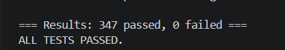

</details>

## Project Files

| File or directory | Purpose |
| --- | --- |
| `Store.h`, `Store.cpp` | Domain rules, structure ownership and CSV persistence |
| `server.cpp` | C++ HTTP API |
| `main.cpp` | Console interface |
| `Order.h` and custom DSA headers | Models and data structures |
| `Delivery.h` | RoutePlanner and trip model |
| `frontend/` | React application |
| `tests.cpp`, `test_api.sh` | Backend and API checks |
| `frontend/src/lib/api.test.ts` | Frontend API-client tests |
| `docs/screenshots/` | Images embedded in this README |
| [`API.md`](API.md) | Endpoint reference and API design |
| `archive/`, `Phase*-Report.md` | Earlier implementation versions and development history |

## Limitations

- Local, single-operator demonstration with no authentication, payment handling or cloud deployment.
- Plain BSTs can become unbalanced.
- Single-file saves use temporary-file replacement. Ordered rollback across CSV writes does not provide a fully crash-safe multi-file transaction.
- Exact stop ordering grows factorially and suits small route sets.
- Dependency audit findings remain unresolved in the documented snapshot.

Potential improvements include balanced indexes, transactional persistence and broader datasets.

---

<p align="center">
  <strong>Abdul Rafay Awan</strong><br />
  BS Artificial Intelligence, Semester 3<br />
  Riphah International University, Faculty of Computing<br />
  Supervisor: Sir Moeed Ahmed
</p>
