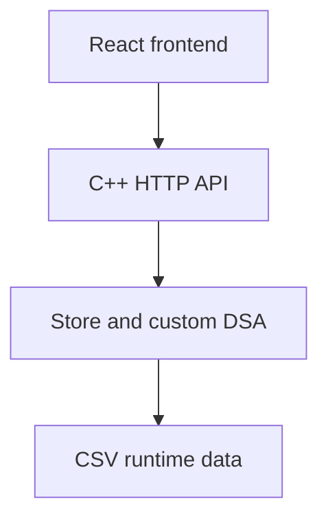

> Source layout updated: C++ sources are in `backend/src/`, public headers in `backend/include/`, vendored headers in `backend/third_party/`. Build with CMake from the root and run `build/bin/server 8080 data/runtime`. API contracts below are unchanged.

# Phase 4A — HTTP API

## 1. HTTP library comparison (checked 13 Nov 2026)

All three are established, open-source C++ HTTP libraries. The choice is about
**fit for this semester project**, not about which is "best" in general.

| | cpp-httplib | Crow | Drogon |
|---|---|---|---|
| What it is | Single-file header-only HTTP/HTTPS library (C++11) | Header-only micro-framework (single header available) | Full async web framework (CMake, C++17) |
| Version checked | **0.66.0** (downloaded 13 Nov 2026, `httplib.h`, 843 KB, MIT) | current master | current master |
| Dependencies (plain HTTP) | **None** — one header, no build step | Asio (standalone or Boost) — must be fetched/configured | trantor (submodule) + jsoncpp + other CMake deps |
| Build | Vendored header; root CMake target `server` | Needs Asio headers + its own header; more setup on Windows | CMake project, install step, heavier setup |
| Windows | Supported (Winsock), same single header | Supported, but Asio setup is the hard part | Supported, but the CMake install is the hard part |
| Routing / JSON | Simple handlers (`svr.Get("/api/orders", ...)`); **no built-in JSON** — this API uses nlohmann/json 3.11.3 (see §4) | Macro routing, built-in JSON | Full routing, ORM, built-in JSON |
| Threading | Thread pool, one handler per request | Thread pool | Async, event loop |
| Size / scope | Small, does one job | Small-medium | Large — a framework, not just HTTP |

**Chosen: cpp-httplib 0.66.0.**

Why, for *this* project:
1. **Vendored headers.** cpp-httplib and nlohmann/json are in `backend/third_party/`. The root CMake build links the platform socket and threading libraries without downloading backend dependencies.
2. **Established and maintained.** ~20k stars, actively maintained, used in production tools; MIT licence. Not a hand-rolled parser (your requirement) and not an obscure choice.
3. **Enough, not more.** The API needs routing, query params, JSON bodies, CORS headers, and a thread pool. httplib does all of that. Crow would add an Asio dependency for no benefit at this scale; Drogon would add a whole framework (ORM, async model, CMake install) for an API that is a thin wrapper over `Store`.

Honest limits of the choice:
- **No built-in JSON.** JSON is handled by nlohmann/json 3.11.3 (`json.hpp`, single header, MIT), vendored in `backend/third_party/` — see §4. It is a general JSON library, not a hand-rolled writer/reader (the Phase 4A hand-rolled code was removed in Phase 4B). One cost: compiling `json.hpp` together with `httplib.h` is slow — the server build takes ~3 minutes on this VM, so allow up to 120 s+ for it.
- **No built-in auth.** The API is bound to `127.0.0.1` only (see §5). There is no login (decision D1: single admin actor). Do not expose it to a network.
- **Thread safety comes from the server, not the library.** `Store` is not thread-safe, so `server.cpp` holds one `std::mutex` around every `Store` call. Requests are handled one at a time inside `Store`; httplib still handles the HTTP work concurrently.

## 2. Architecture



**No business logic is duplicated.** The server is a translator: HTTP + JSON in, `Store` method out, JSON back. Every rule (transition table, queue invariant, assignment rules, rollback) lives in `Store`/`RoutePlanner` exactly as in Phases 3a–3c. The console (`main.cpp`) and the server share the same `Store` code and the same CSV files.

**Server:** `server.cpp` (new). Usage: `build/bin/server [port] [data_dir]` — default port `8080`, default data dir `.` (the process working directory); pass `data/runtime` when starting from the project root. On startup it loads all four files, prints the recovery report (see §6), and listens on `127.0.0.1` only.

## 3. Endpoints

Base: `http://127.0.0.1:8080/api`. All responses are JSON. Errors are
`{"error": "message"}` with a meaningful status (400 bad input, 404 not found,
409 conflict, 500 server error). `GET` endpoints never change data, except
`plan`/`detour`/`multi-stop`, which append one `ROUTE_GENERATED` log entry
(the audit requirement from Phase 3c — see §7), unless `audit=false` is
passed (Phase 4B-5, read-only demonstrations).

| Method + path | What it does (Store method) | Success |
|---|---|---|
| `GET /api/health` | Server up? + recovery warnings | 200 `{status, orders, trips, logs, recovery}` |
| `GET /api/stats` | Dashboard counts + sales | 200 |
| `GET /api/analytics` | Status counts + daily orders/sales | 200 |
| `GET /api/benchmark` | Live List-vs-BST 1,000-search steps | 200 |
| `GET /api/orders?status=&city=&date=` | List, filter by status/city/date | 200 `[order...]` |
| `GET /api/orders/:id` | One order (BST search) + its history | 200 / 404 |
| `GET /api/orders/tree` | Whole Order BST `{root, size, height}` — recursive walk (Phase 4B-4) | 200 |
| `GET /api/orders/csv-preview` | Bounded read-only preview of the actual runtime `orders.csv` (fixed path, first 10 data rows) | 200 `{available, path, header, rows, preview_rows, total_rows, truncated}` |
| `POST /api/orders` | Add order (validates price > 0, quantity ≥ 1, non-empty fields, date format) | 201 / 400 |
| `PATCH /api/orders/:id/status` | `{status}` — transition table enforced | 200 / 400 / 404 |
| `POST /api/orders/:id/cancel` | Cancel (Pending/Processing only) | 200 / 400 / 404 |
| `DELETE /api/orders/:id` | Delete order | 200 / 404 |
| `GET /api/queue` | Pending queue, front → rear, with order details | 200 |
| `POST /api/queue/process` | Process next (FIFO) | 200 / 409 (empty) |
| `POST /api/undo` | Undo last action | 200 / 409 (nothing to undo) |
| `GET /api/delivery/graph?dataset=` | Cities + edges of the network (read-only) | 200 / 400 |
| `GET /api/delivery/plan?source=&destination=&dataset=` | Route + intermediate matches + destination orders | 200 / 400 |
| `GET /api/delivery/detour?source=&destination=&via=&dataset=` | Original vs via-route, extra time/distance, eligible orders | 200 / 400 |
| `POST /api/delivery/multi-stop` | `{source, destination, stops:[], dataset?}` — exact best route | 200 / 400 |
| `GET /api/delivery/trips` | All trips | 200 |
| `POST /api/delivery/trips` | `{source, destination, stops:[], order_ids:[]}` — assignment rules enforced, **production routes only** | 201 / 400 |
| `POST /api/delivery/trips/:id/complete` | Explicit completion only | 200 / 400 / 404 |
| `POST /api/delivery/trips/:id/cancel` | Cancel a Planned trip, release orders to Processing | 200 / 400 / 404 |
| `GET /api/logs?order_id=&action_type=&from=&to=` | Chronological logs, filters | 200 |
| `GET /api/logs/:id` | One log entry by log ID | 200 / 404 |
| `GET /api/logs/tree` | Whole Activity Log BST `{root, size, height}` — recursive walk (Phase 4B-4) | 200 |

### Tree endpoints (Phase 4B-4)

- `GET /api/orders/tree` returns `{"root", "size", "height"}` where each
  node is `{"order_id", "customer_name", "city", "status", "left", "right"}`
  (a null child is JSON `null`). `size` is the number of orders;
  `height` is computed by a real recursive walk — 0 for an empty tree,
  1 for a single node.
- `GET /api/logs/tree` returns the same shape for the Activity Log BST:
  each node is `{"log_id", "timestamp", "action_type", "order_id",
  "left", "right"}`, `size` is `logTree.size`, `height` is the same
  recursive walk. Note the log tree leans right (timestamps arrive in
  increasing order and the tree is not self-balancing), so its height is
  close to its size — that is expected, not a bug.
- Both trees are returned **whole**, not paged: the dataset is small
  (30 orders, tens of log entries), and the point of the endpoints is to
  show the actual tree shape on the Logs / Orders pages. Do not use them
  on a large dataset without paging.
- Both routes are registered **before** their `/:id` siblings, so
  httplib does not read `"tree"` as an ID.

### CSV preview endpoint ("How CSV becomes orders")

`GET /api/orders/csv-preview` powers the educational panel on the Orders
page. It reads the **actual runtime orders file** — the same
`store.ordersPath` that `loadOrders()` reads at startup and that every
successful mutation rewrites atomically (temp file + rename) — and returns
a bounded preview of its raw text:

```json
{
  "available": true,
  "path": "data/runtime/orders.csv",
  "header": "order_id,customer_name,product,category,price_pkr,quantity,order_date,city,status",
  "rows": ["1001,Ahmed Raza,...", "..."],
  "preview_rows": 10,
  "total_rows": 30,
  "truncated": true
}
```

- `path` is the configured runtime file exactly as the server was started
  (`build/bin/server 8080 data/runtime` → `data/runtime/orders.csv`). It is
  a label for the UI; **the client cannot select a file** — no path,
  filename, or query input of any kind is accepted (a `?path=` parameter
  is ignored). The route is registered **before** `/api/orders/:id`, like
  `/api/orders/tree`.
- The preview is bounded: at most the first **10 data rows**, each line
  capped at 2,000 characters (CRLF line endings are normalised). `rows`
  are raw file lines as text, exactly as stored — the loader may skip a
  malformed line, the preview does not edit or interpret anything.
  `total_rows` counts all non-empty data lines in the file; `truncated`
  says whether rows were left out.
- **Missing/unreadable file → HTTP 200** with `"available": false`, empty
  `header`/`rows`, zero counts, and a `message`. This is deliberate: the
  endpoint is a best-effort teaching preview, so it degrades gracefully
  instead of erroring. The server keeps running, the orders already
  loaded in memory are unaffected, and the next successful change
  recreates the file (the usual atomic save).
- The file is read under the same mutex as every other handler. Saves are
  atomic, so a reader sees the old file or the new file whole — never a
  half-written one. The endpoint is read-only: it adds no write path, and
  localhost binding + CORS are unchanged.
- The frontend renders the returned text as plain text (React text
  nodes), never as HTML.

### Graph endpoint + dataset demo mode (Phase 4B-3)

- `GET /api/delivery/graph?dataset=production|test` returns `{"dataset", "cities": [...], "edges": [{"from", "to", "time_min", "distance_km"}]}` — one edge per undirected road, built from the loaded graph matrices. Production: 6 cities, 12 edges. Test: 6 cities, 11 edges (no Lahore–Islamabad direct edge).
- `dataset` (default `production`) is accepted by the read-only planning endpoints only: `plan`, `detour`, and `multi-stop` (query param for the GETs, optional `"dataset"` field in the multi-stop body). Planning in test mode uses the test graph for the route AND for intermediate/detour/multi-stop matching, and still logs one `ROUTE_GENERATED` entry unless `audit=false`. Unknown dataset → 400; `dataset=test` when `test_routes_intermediate.csv` is missing next to the routes file → 400 "Test dataset not available".
- **Read-only demonstrations (`audit=false`, Phase 4B-5).** `plan` and `detour` accept `?audit=false`; `multi-stop` accepts `"audit": false` in the JSON body. With `audit=false` the route is computed and returned exactly as usual, but NO `ROUTE_GENERATED` log entry is appended and there is no `log_warning` field. Default (parameter absent) is audited. Any other value → 400 naming the parameter (`"Query parameter 'audit' must be 'true' or 'false.'"` / `"Field 'audit' must be true or false."`). The DSA Performance page uses `audit=false` for all three of its planning calls, so viewing it no longer grows the activity log; the Delivery Planner keeps the audited default.
- **Trip creation is production-only.** `POST /api/delivery/trips` with `"dataset":"test"` returns 400 "Trips can only be created on the production routes." A demo-mode route must never mark real orders Shipped on a route that does not exist in production.
- The test graph is loaded at startup from `test_routes_intermediate.csv` in the same folder as the production routes file, if present. The production routes file is never modified.

### Trip cancellation rules (Phase 4A, requirement 4)
- Only a **Planned** trip can be cancelled. A Completed trip is history; a
  Cancelled trip is already cancelled. Both return 400.
- Each assigned order is **released back to Processing** — the exact status
  it had before assignment (assignment required Processing, so this is
  deterministic). This is a deliberate reversal, like Undo: it bypasses the
  forward transition table, because there is no forward Shipped → Processing
  transition.
- The cancellation is logged as `TRIP_CANCELLED` (once for the trip,
  once per released order). A cancelled trip is **not active**, so its orders
  may be assigned to a new trip afterwards.
- The three files are committed with the same `commitTripWithLogs` rule as
  creation/completion (orders → trips → logs, rollback on any failure).

## 4. JSON

**nlohmann/json 3.11.3 is vendored** (`json.hpp`, single header, MIT) and
used for ALL JSON output and input parsing in `server.cpp`. The hand-rolled
JSON writer/reader from Phase 4A (`jsonEscape`, `q`, string-built
`orderToJson`/`tripToJson`/`logToJson`, `findKey`/`getStringField`/
`getIntField`/`getIntArray`/`getStringArray`) was deleted in Phase 4B.

- Output: `orderToJson` / `tripToJson` / `logToJson` now return
  `nlohmann::ordered_json` objects, and responses are sent with
  `body.dump()`. `ordered_json` is used (not plain `json`) so response
  fields keep the insertion order Phase 4A produced. Escaping of
  `"`, `\`, control characters and unicode is the library's job —
  verified with a customer name containing a quote, a backslash and
  `é`, which round-trips correctly (checked by curl in the Phase 4B
  verification run, 13 Nov 2026).
- Input: `parseBody()` runs `json::parse` inside try/catch and requires
  the result to be a JSON object — a malformed body (`{not json`) or a
  non-object body (`[1,2,3]`) returns 400 naming the endpoint's first
  required field, never a crash. Typed readers (`getStringField`,
  `getIntField`, `getIntArray`, `getStringArray`) check
  `contains()` + `is_string()` / `is_number_integer()` /
  `is_array()` before reading, so a wrong-typed field (e.g.
  `"price_pkr": "5000"`) returns 400 naming that field. Numbers are
  validated as before (price > 0, quantity ≥ 1).

## 5. CORS + localhost

- The server binds to **`127.0.0.1` only** — it is not reachable from another
  machine. That is deliberate for development (and for a university demo).
- CORS allows the local React dev server from **both** addresses Vite can
  be opened at: `http://localhost:5173` **and** `http://127.0.0.1:5173`
  (same server, but the browser treats them as different origins — the
  server echoes back whichever of the two the request came from). Methods
  `GET, POST, PATCH, DELETE, OPTIONS`, headers `Content-Type`. Preflight
  `OPTIONS` requests are answered with 204. If the frontend runs on
  another port, change the list in `server.cpp` (`kCorsOrigins`).
  Any other origin is not echoed, so the browser blocks it.

## 6. Recovery (Phase 4A, requirement 5)

`Store::checkRecovery()` (new) runs at startup and is exposed in
`GET /api/health` under `recovery`. It reports, never auto-fixes:
- **Leftover `.tmp` files** (`orders.csv.tmp`, `delivery_trips.csv.tmp`) —
  a save interrupted before the replace. The original CSV is the good copy;
  delete the `.tmp`, do not load from it.
- **Corrupt lines skipped** on load (`logsSkipped`, `tripsSkipped`).
- **Trip/order inconsistencies** — a Planned trip whose order is not
  Shipped, a Completed trip whose order is not Delivered, an order assigned
  to more than one active trip, a trip listing a missing order. These can
  only happen if the files were edited by hand or a crash hit between the
  orders save and the trips save.
- The queue is **rebuilt from orders.csv on every load** (Pending only), so
  it cannot be stale after a restart — that is the recovery for the queue.

Multi-file commit order (from Phase 3c, unchanged): orders → trips → logs,
with rollback + re-save on failure, and an explicit `CRITICAL` error if the
re-save also fails.

## 7. What planning logs (and why)

`plan`/`detour`/`multi-stop` are `GET`s, but they append one
`ROUTE_GENERATED` log entry each. That is the Phase 3c audit requirement:
route generation is recorded. Planning still changes **no order status** —
only the log file grows. If the log write fails, the route is still returned
and the error is reported in the response (`"log_warning"`), because refusing
a read over a log failure would be worse than returning the route.

**Exception (Phase 4B-5):** `audit=false` skips the log entry entirely, for
read-only demonstrations that must not change the audit trail just by being
viewed (the DSA Performance page). With `audit=false` there is no log write
to fail, so there is never a `log_warning` either.

## 8. Testing

- `tests.cpp` — the 266 C++ regression checks, plus new groups for trip
  cancellation and recovery (see `../reports-documents/development-history/Phase4a-Report.md`).
- `test_api.sh` — automated integration test: starts the server on a test
  port with a copy of the data in `/tmp`, runs `curl` against **every**
  endpoint (success + error cases), checks the JSON with `python3 -m json.tool`
  / `grep`, and stops the server. Run: `bash backend/tests/test_api.sh`.
- Manual `curl` examples are in `../reports-documents/development-history/Phase4a-Report.md` §5.

## 9. Limitations

- Build and regression checks have recorded Windows results. Current commands are in [Windows setup](WINDOWS_SETUP.md). CMake links Winsock automatically.
- No auth, no HTTPS — localhost only, by design (decision D1).
- No rate limiting. For a local demo this is fine; do not expose the port.
- JSON is now handled by nlohmann/json (§4) — the hand-rolled JSON
  limitation from Phase 4A no longer applies. The server build is slow
  (~3 min on this VM) because `json.hpp` + `httplib.h` are both large
  headers; that is a compile-time cost only.
